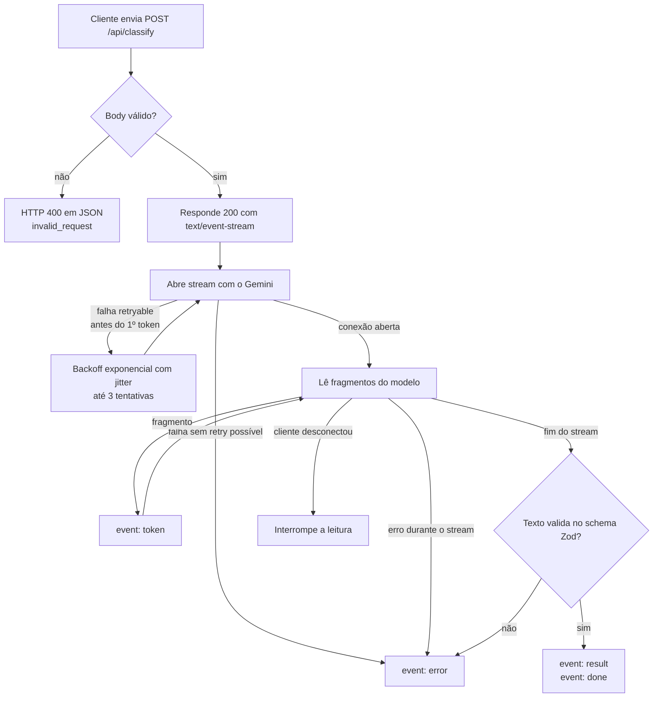

# Fluxo da requisição

Este documento descreve o caminho de `POST /api/classify`, desde a requisição até o último evento SSE.

## Diagrama

## Regras

- **Retry só antes do primeiro token.** Depois que um `token` foi enviado, uma falha gera `error` direto, sem nova tentativa.
- **Nenhum `result` sem validação.** Os tokens são exibidos como texto parcial. O JSON só vira `result` depois de passar pelo schema.
- **Erros tipados.** Todo `error` traz `code`, `message`, `retryable` e `requestId`.

## Códigos de erro

| `code` | Quando ocorre | `retryable` |
|---|---|---|
| `rate_limited` | Gemini respondeu 429 | `true` |
| `provider_error` | Gemini respondeu 5xx | `true` |
| `provider_error` | Gemini respondeu outro 4xx | `false` |
| `timeout` | A chamada excedeu o tempo limite | `true` |
| `invalid_output` | A saída não passou no schema | `false` |
| `invalid_request` | Body inválido (resposta HTTP 400, sem SSE) | `false` |